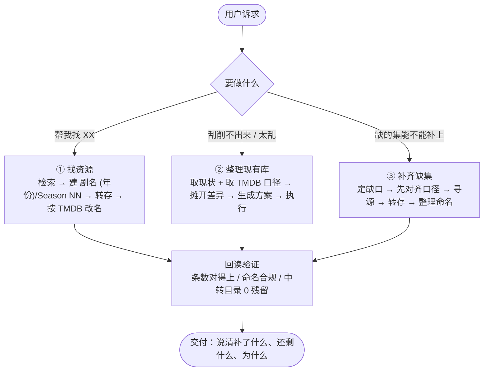

# media-library-manager · 网盘影视库管家

**让网盘里的剧集和电影，被 Jellyfin / Emby / Plex / Kodi / 电视端正确刮削。**

给它一堆命名混乱、季划分随意的视频文件，它按 **TMDB 的季集结构**理成标准形态；或者反过来说 ——
你要找的剧、你缺的那几集，它也负责找回来并放到正确的位置、改成正确的名字。

---

## 它解决什么问题

从各种渠道收集来的影视文件，通常有这些毛病：

- 文件名是 `第1季 第01集 第02集.mp4` 或 `Bluey S01E03.mp4` —— 刮削器认不出；
- 季划分是资源打包者自己排的，和 TMDB **对不上**，导致集号整体错位、海报和简介全是隔壁集的；
- 缺了几集，但**说不清缺的是哪几集**（因为两套口径下的答案不一样）；
- 补了文件进去，媒体库里还是看不到（文件堆在中转目录，没归位也没改名）。

这个 skill 就是把这四件事做成一套可重复的流程。

## 三件事



## 五条铁律

1. **先对齐口径，再谈改名。** 「缺哪几集」这个问题本身可能不唯一。
2. **TMDB 是唯一权威，且只按标题映射、不按编号搬运。** 分享方的集号与 TMDB 常差几十位。
3. **命名合规 ≠ 刮削正确。** 名字没毛病、刮削照样错位，根因在元数据口径。
4. **转存 ≠ 归位。** 搬进网盘只完成一半，还要移进目标季目录并改名。
5. **交付前必须回读验证。** 不看「任务成功」，看目录里实际有什么。

## 三步上手

```bash
# 0）准备两份数据
#    ① 库内文件清单（.jsonl / .json / .txt，见 references/data-formats.md）
#    ② TMDB 分集数据（有 API Key 最省事；被 Cloudflare 拦时走镜像，见 references/tmdb-data.md）

# 1）先看缺口 + 结构差异（不改任何东西）
node scripts/scan-coverage.mjs --library local.jsonl --tmdb tmdb.json

# 2）生成改名方案（本地已做字符集/长度/重名校验，不会撞接口的校验器）
node scripts/gen-rename-plan.mjs --library local.jsonl --tmdb tmdb.json \
     --show "Bluey" --out plan.tsv

# 3）改完再验一次（退出码非 0 即有问题，可直接当 CI 门禁）
node scripts/validate-names.mjs --files local.jsonl --show "Bluey"
```

`scan-coverage.mjs` 的典型输出：

```
季    库内文件  TMDB集数  覆盖集号  缺失集号  越界集号  标题存疑
S01  26      26      26     -      -       -
S02  25      25      25     -      -       -
S11  7       50      7      E15-E50   -      -
S12  0       20      0      E01-E20   -      -
```

一眼就能看出「前两季完整、S11 从中间截断、S12 全缺」。

## 能力映射：你需要的网盘工具

本 skill 是**流程 + 判据 + 校验脚本**，不绑定具体网盘。文件操作部分需要你自备一个能操作网盘的命令行工具。
把下面这些能力换成你所用工具的等价操作即可（命令示例中的语义以夸克网盘 CLI 为例）：

| 需要的能力 | 语义 | 本 skill 用在哪 |
|---|---|---|
| 列目录（递归/落盘） | `browse --parent-fid <FID> --all` | 取库内现状（**读落盘产物**，别读回显预览） |
| 搜索 | `search --keyword "<名>" [--search-type dir]` | 先查站内是否已有 |
| 建目录 | `create-folder --dir-path "<名>" --parent-fid <FID>` | 建 `剧名 (年份)/Season NN` |
| 转存分享 | `saveas --url <链接> --fid-list <FID,…> --to-pdir-fid <目标目录FID>` | 定向转存（**一步落位**） |
| 批量移动+改名 | `file-organize`（init → check → apply → undo） | 整理归位与改名 |
| 看分享结构 | `share-detail --url <链接> --pdir-fid <FID>` | 逐层核实资源完整性 |

**没有现成 CLI 也可以**：手动导出文件清单成 `.jsonl` / `.txt`，三个脚本照样能用 —— 它们只吃文件清单。

## 目录结构

```
SKILL.md                      主入口：三件事的路由 + 铁律 + 命名速查
references/
  workflow-find.md            ① 找资源
  workflow-organize.md        ② 整理现有库
  workflow-fill-gaps.md       ③ 补齐缺集
  naming-spec.md              命名规范（剧集/电影/双集/特辑）
  tmdb-data.md                TMDB 数据获取（含 Cloudflare 被拦时的镜像法）
  data-formats.md             脚本输入输出格式
  pitfalls.md                 实测踩坑库（**最值钱的一份**）
scripts/
  lib/common.mjs              公共解析与校验
  scan-coverage.mjs           覆盖度报告
  gen-rename-plan.mjs         改名方案生成 + 本地校验
  validate-names.mjs          命名校验（可当门禁）
```

## FAQ

**Q：一定要用 TMDB 吗？**
建议是。它是目前覆盖面最广、媒体服务器支持最好的元数据源。换别的源时，把「取口径」这一步替换掉即可，其余流程不变。

**Q：`scan-coverage` 报了几个集号是空的，但我说什么也找不到那几集？**
先看 [pitfalls.md](references/pitfalls.md) 1.2 —— 很可能是元数据源自己把下一季开头重复挂进了本季，**不是你的库缺**。

**Q：`gen-rename-plan` 跳过了几个文件，为什么？**
报告的「跳过原因」会写明：没有 `SxxEyy` 集号 / 元数据源该季没有这个集号 / 新名含非法字符。逐条看即可。

**Q：能不能让它直接帮我把文件搬好？**
可以，但需要一个有「批量移动+改名」能力的网盘工具。`gen-rename-plan --proposal` 能输出符合常见整理接口格式的方案，配合你自己的工具执行。

**Q：`validate-names` 报「集号空洞」是错吗？**
不一定。TMDB 自身会产生空洞（见 1.2），而集合本身缺集也正常。**但要能解释**，否则就是没补全。

**Q：支持电影吗？**
支持。电影命名更简单：`片名 (年份)/片名 (年份).ext`，没有季和集号，脚本不适用（也用不上），手工做即可。

## 兼容性与验证状态

| 部分 | 状态 |
|---|---|
| 命名规范（Jellyfin / Emby / Plex / Kodi 的多集写法、保留字符） | **已实测**，依据各家官方文档 |
| 三个 `scripts/` 脚本 | **已实测**（含双集、缺号、越界、非法字符、proposal 输出等场景） |
| 「先对齐口径再动手」的流程与判据 | **已实测** |
| 元数据镜像站的可用性 | **已实测但会随时效变化** —— 站点的接口可能失效，需现场验证 |
| 具体网盘工具的命令差异 | **需自行验证** —— 命令语义按能力映射表替换 |

## 安全与隐私

- 本 skill **不含任何凭据、账号、网盘文件 ID 或分享链接**；
- `scripts/` 只做本地文件解析与校验，**不发起网络请求**；
- TMDB API Key 请自行通过环境变量或本地配置传入，**不要提交进版本库**；
- 详见 [SECURITY.md](SECURITY.md)。

## 免责声明

- 本 skill 提供的是**文件组织与命名的方法与工具**，不提供任何影视内容，也不代你下载受版权保护的内容；
- 使用中涉及的资源来源、版权与合规性，由使用者自行负责；
- 脚本会对你的文件清单做校验，但**执行改名/移动前请自行确认方案**（工具通常提供撤回窗口，但仍建议先小批量试）。

## English TL;DR

**media-library-manager** — organize netdisk / local TV & movie files so that Jellyfin, Emby, Plex, Kodi and TV clients scrape them correctly, aligned to **TMDB** season/episode structure.

It covers three jobs: **① find resources** (build `Show (Year)/Season NN`, transfer in, rename to spec), **② tidy an existing library** (detect structure mismatches, batch rename to TMDB order), **③ fill missing episodes** (diff against TMDB, locate sources, transfer and organize).

Key rules: align on one numbering convention *before* renaming; map by **title**, never by the source's episode numbers; transferring a file is *not* the same as placing it correctly; always verify by re-reading the directory.

`scripts/` are plain Node.js (≥16), network-free, and work on any file listing (`.jsonl` / `.json` / `.txt`) — no netdisk lock-in.

## License

MIT — see [LICENSE](LICENSE).
